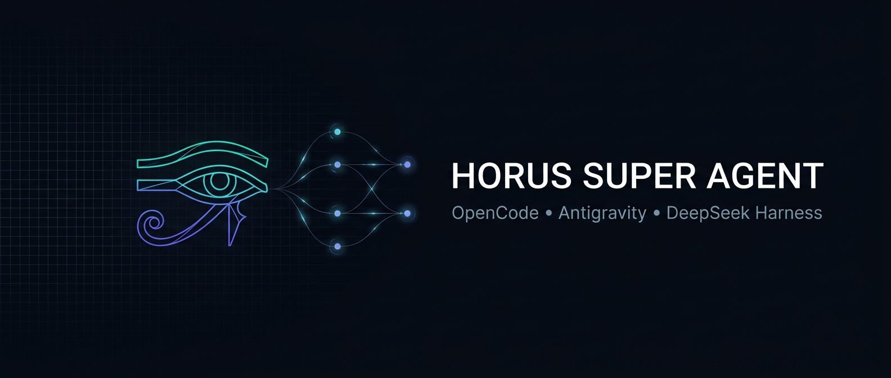
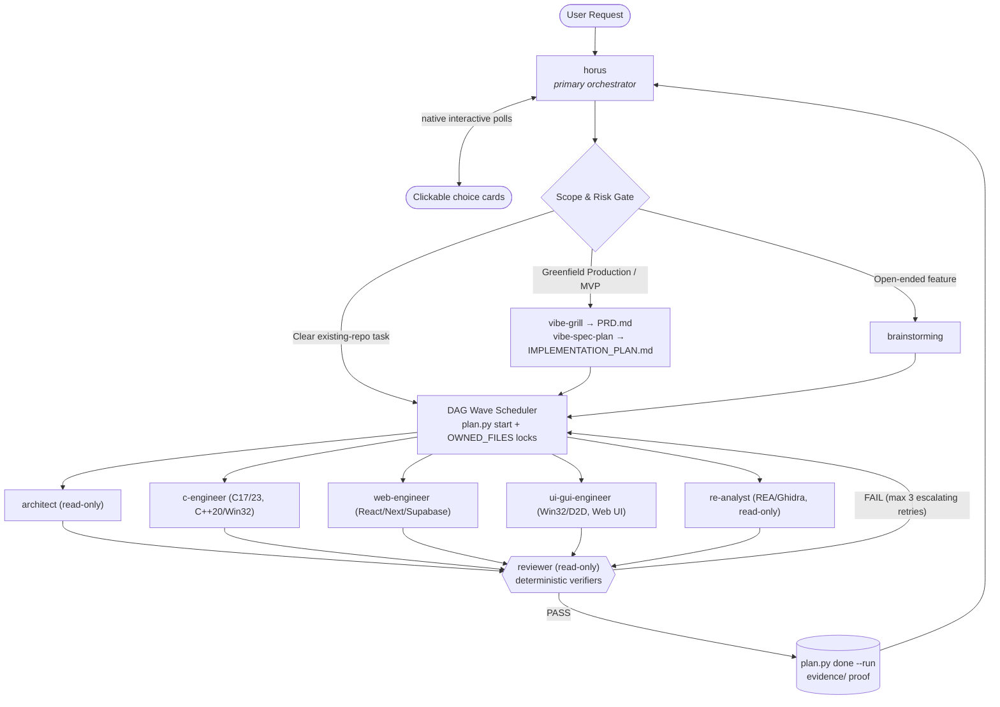

<div align="center">



# Horus Super Agent

**A frontier multi-harness DAG-wave orchestrator and 41-skill engineering suite for [OpenCode](https://opencode.ai), Google Antigravity, and DeepSeek Harness Desktop App (`dsh`).**

Specs before code · File-locked parallel subagents · Mechanical proof-gated task closure · 4-layer zero-overlap memory · Zero catalog bloat.

[](.github/workflows/ci.yml)
[](CHANGELOG.md)
[](#standalone-global-install-recommended--works-for-every-app)
[](SKILLS.md)
[](#the-7-agents)
[](#slash-commands--workflows)
[](#installation)
[](LICENSE)

</div>

<p align="center">
  <a href="#why-horus-exists">Why Horus</a> ·
  <a href="#architecture--execution-engine">Architecture</a> ·
  <a href="#installation">Installation</a> ·
  <a href="#4-layer-memory-context--knowledge-graph">4-Layer Memory</a> ·
  <a href="#the-7-agents">Agents</a> ·
  <a href="#slash-commands--workflows">Commands</a> ·
  <a href="#the-41-skills">Skills</a> ·
  <a href="#tooling--scripts">Tooling</a> ·
  <a href="#configuration--verification">Config & Verify</a>
</p>

---

## Why Horus Exists

Most coding-agent setups break down in the same predictable ways: they write code before locking requirements, check off tasks without proof, burn context re-reading raw files, overwrite each other in parallel runs, or bloat the system prompt with dozens of overlapping skills.

Horus makes those failure modes structurally hard — across **OpenCode (V1/V2)**, **Google Antigravity (IDE & `agy` CLI)**, and **DeepSeek Harness Desktop App (`dsh`)**:

| Failure Mode | How Horus Prevents It |
| :--- | :--- |
| **Code before specs** | Adaptive kickoff gate + `vibe-grill` / `brainstorming` locks `PRD.md` and vertical slices before editing |
| **Hand-ticked "done"** | `plan.py done <id> --run "<cmd>"` requires exit code `0` and writes SHA-256 / log proofs to `evidence/`; hand-edited `[x]` fails `plan.py verify` as `UNPROVEN` |
| **Context window drift & bloat** | 4-layer stack: `graphify` AST queries + `horus-context-mode` SQLite FTS5 sandbox + `horus-memory` wiki + `HANDOFF.md` |
| **Parallel edit collisions** | Every wave task declares `OWNED_FILES`; only strictly disjoint file sets execute concurrently |
| **Skill catalog bloat & overlap** | Hard mechanical cap enforced by `validate_horus.py`: every skill description ≤ 150 chars (`4,937` chars total across 41 skills), **0** duplicate sub-playbooks |
| **Sycophantic self-review** | Read-only `reviewer` runs deterministic linters/typecheckers/tests (`mypy`, `ruff`, `bandit`, `semgrep`, `pytest`, `tsc`, `playwright`) and returns `PASS`/`FAIL` with `file:line` evidence |
| **Bureaucratic friction on simple tasks** | Smart autonomy executes clear, scoped existing-repo tasks directly and reserves interactive polls for greenfield kickoffs, architectural forks, and destructive actions |

---

## Architecture & Execution Engine



### Adaptive Pipeline Routing

Horus picks the smallest pipeline that satisfies the request:

| Pipeline | Trigger | Sequence |
| :--- | :--- | :--- |
| `TRIVIAL` | ≤ 1 file touched | worker → verify |
| `STANDARD` | Multi-file feature or refactor | `architect` → parallel worker wave → `reviewer` |
| `REVERSE-ENGINEERING` | Binary / PE / legacy C++ port | `re-analyst` (REA/Ghidra spec) → `c-engineer` → `reviewer` |
| `WEB` | Web product or full-stack slice | `architect` (`vibe-spec-plan` + `speed-engineer`) → `web-engineer` (+ `ui-gui-engineer`) → Playwright E2E → `reviewer` → `vibe-test-gate` |
| `CORE + UI` | Native desktop application | `architect` freezes contract → parallel `c-engineer` + `ui-gui-engineer` → integration build → `reviewer` |
| `AUDIT / HARDENING` | Security or codebase audit | `senior-engineering-partner` (`AUDIT:`) / `security-audit` → user selects fixes → worker wave → `reviewer` |

### 3-Attempt Escalating Retry Circuit Breaker
1. **Attempt 1:** Re-dispatch worker with only `BLOCKERS`/`MAJORS` at exact `file:line`.
2. **Attempt 2:** Refresh Graphify slice, attach exact failing stderr/logs, challenge the root-cause hypothesis, re-dispatch.
3. **Attempt 3 (Circuit Breaker):** `plan.py block <id> "<reason>"` and pause with an interactive poll (*Expand Scope & Retry*, *Alternative Approach*, or *Keep Blocked & Handoff*).

---

## Installation

**Requirements:** Python 3.8+ (zero third-party dependencies for Horus scripts), PowerShell 5.1+ or Bash, and Node.js 22.5+ (only if enabling `horus-context-mode` MCP's built-in `node:sqlite`).

### Standalone Global Install (Recommended — Works for EVERY App)

Install Horus **once** and have every skill, agent, workflow, hook template, MCP server, and Python script resolve standalone from **any project or empty workspace** across **OpenCode**, **Google Antigravity (IDE & CLI)**, and **DeepSeek Harness Desktop App (`dsh`)**:

```powershell
# Windows PowerShell — install standalone globally for ALL 3 apps
.\install.ps1 -Mode global -Harness all -ApplyDshProfiles
```

```bash
# Linux / macOS — install standalone globally for ALL 3 apps
bash install.sh global --harness all --apply-dsh-profiles
```

You can also target a single app (`-Harness opencode`, `-Harness antigravity`, or `-Harness dsh`):

```powershell
.\install.ps1 -Mode global -Harness opencode
.\install.ps1 -Mode global -Harness antigravity
.\install.ps1 -Mode global -Harness dsh -ApplyDshProfiles
```

### Per-Project Install (Single Repository)

```powershell
# Windows PowerShell (OpenCode default, or pass -Harness antigravity | dsh | all)
.\install.ps1 -Mode project -TargetDir "C:\path\to\your\repo"
.\install.ps1 -Mode project -TargetDir "C:\path\to\your\repo" -Harness all
```

```bash
# Linux / macOS
bash install.sh project /path/to/your/repo
bash install.sh project /path/to/your/repo --harness all
```

### Multi-Harness Layout Matrix

Horus maintains a **single canonical source of truth** in `.opencode/` and adapts paths, frontmatter, and MCP configs automatically via `scripts/install_harness.py`:

| Harness | Standalone Global Layout | Per-Project Layout | Rules & MCP Integration |
| :--- | :--- | :--- | :--- |
| **OpenCode (V1/V2)** | `~/.config/opencode/{agents,skills,commands,context-mode,scripts}` | `.opencode/{agents,skills,commands,context-mode}` | Strict `opencode.json` (global) / `opencode.jsonc` (project) + `AGENTS.md` |
| **Google Antigravity** | `~/.gemini/config/{skills,workflows,rules,agents,context-mode,scripts}` | `.agents/{skills,workflows,rules,agents,context-mode}` | Marked `<!-- HORUS:BEGIN -->` block in `~/.gemini/GEMINI.md` (or project `GEMINI.md`) + non-destructive merge into **both** `~/.gemini/config/mcp_config.json` & `~/.gemini/antigravity/mcp_config.json` |
| **DeepSeek Harness (`dsh`)** | `$DSH_HOME/skills/` + `$DSH_HOME/horus/{agents,commands,context-mode,scripts}` | `skills/` + `.dsh/{agents,commands,context-mode}` | Marked block in `$DSH_HOME/AGENTS.md` (or project `AGENTS.md`) + validated `@deepseek-ai/dsh-mcp-client` Cordis YAML patch (`cordis.patch.yml`, auto-wired into existing profiles with `-ApplyDshProfiles`) |

> **Upgrading safely:** Pass `-ForceConfig` / `--force-config` only when you want to overwrite existing `AGENTS.md` or `opencode.jsonc` (saves a `.bak` backup first). If you use `ai-memory`, upgrade OpenCode globally **without** `-ForceConfig` so your global `opencode.json` MCP entries stay intact.

### Optional Companion Tools

```bash
# 1. Local AST knowledge graph + optional graphify-mcp server
uv tool install --upgrade "graphifyy[mcp]"

# 2. Cross-session / cross-project Markdown wiki memory daemon (ai-memory)
# Linux / macOS:
curl -fsSL https://github.com/akitaonrails/ai-memory/releases/latest/download/install.sh | sh
# Windows (PowerShell):
# irm https://github.com/akitaonrails/ai-memory/releases/latest/download/install.ps1 | iex
ai-memory setup --yes --agent opencode2        # OpenCode V2 (--agent opencode for V1)
ai-memory setup --yes --agent antigravity-cli  # Google Antigravity CLI/IDE
ai-memory install-mcp --client dsh             # DeepSeek Harness (prints Cordis YAML patch)

# 3. REA binary / PE reverse engineering toolkit
npx -y rea-agents@latest setup

# 4. Playwright browser verification for webapp-testing
pip install playwright && python -m playwright install chromium
```

---

## 4-Layer Memory, Context & Knowledge Graph

Horus separates code topology, cross-session memory, ephemeral log sandboxing, and execution proofs into **four strictly non-overlapping layers**:

| Layer | Skill / Engine | Responsibility | Storage & Concurrency |
| :--- | :--- | :--- | :--- |
| **1. Codebase Topology** | `graphify` (`graphifyy` v0.9.115) | Static AST graph: symbols, callers, god nodes, shortest paths, blast radius | `<repo>/graphify-out/graph.json` (per-repo, 0 LLM tokens via `--code-only`) |
| **2. Cross-Session Memory** | `horus-memory` (`ai-memory`) | Cross-session, cross-project & cross-agent durable Markdown wiki, decisions, gotchas, handoffs, inbox | `~/.local/share/ai-memory/` (git-backed wiki + `127.0.0.1:49374` Rust daemon) |
| **3. Output Sandbox** | `horus-context-mode` | SQLite FTS5 (BM25 + Trigram RRF) & sandboxed `ctx_execute` to keep huge logs/dumps out of context | `~/.horus-context-mode/context.db` (`WAL` + 5s `busy_timeout`, safe across all 3 apps) |
| **4. Execution Proof** | `planning-with-evidence` (`plan.py`) | Current repo DAG wave plan, file locks, SHA-256/command proof logs, and `HANDOFF.md` | `<repo>/task_plan.md`, `evidence/`, `HANDOFF.md` |

### `horus-memory` (`ai-memory`) + `graphify` Best-of-Both Setup

Source-verified against both codebases — **keep both**, they solve orthogonal problems and have **zero port, storage, hook, or MCP namespace conflict**:

- **Subagent-safe:** `ai-memory`'s OpenCode V2 plugin explicitly skips child sessions with `parentID`, so Horus's parallel DAG workers never steal root handoffs or receive duplicate system injections.
- **Run `ai-memory` always-on (plugin + MCP):** After `ai-memory setup`, delete any 7 extra `ai-memory-*` skill folders it writes so Horus's single consolidated `horus-memory` skill remains the sole entry point with zero catalog bloat.
- **Run `graphify` CLI-first by default:** Use `graphify extract . --code-only`, `graphify query/path/explain`, and `graphify update .` for **0 extra MCP tool-schema tokens** per turn (uncomment `graphify-mcp` only in massive repos).
- **Never run `graphify opencode install`:** Horus already bundles the full Graphify v0.9.115 OpenCode skill and `/graphify` command; Graphify's `graphify.js` plugin prepends an `echo` reminder to your first shell command, which pollutes `ai-memory` tool capture.
- **Keep boundaries clean:** Never paste raw `graphify-out/` dumps into `ai-memory` durable wiki pages.

---

## The 7 Agents

| Agent | Role | Step Budget | Writes? |
| :--- | :--- | :---: | :---: |
| **`horus`** | Primary orchestrator: first-principles planning, parallel waves, native polls, proof gates, escalations | Primary | Coordinates |
| **`architect`** | Systems, web, cloud & UI architect: Graphify mapping, frozen contracts, disjoint DAG plans | 25 | Read-only |
| **`c-engineer`** | Modern C17/C23 and C++20/Win32 systems engineering, zero-UB, ABI `static_assert` checks | 40 | Owned files |
| **`ui-gui-engineer`** | Win32/Direct2D, Dear ImGui, GTK4, SDL3, Clay, and accessible modern web UI craft | 40 | Owned files |
| **`web-engineer`** | React/Next.js, Supabase/Postgres, `speed-engineer`, Playwright browser-verified delivery | 40 | Owned files |
| **`re-analyst`** | REA/Ghidra/IDA binary analysis into VA/RVA-grounded specs and golden test vectors | 30 | Read-only |
| **`reviewer`** | Adversarial spec, security, memory-safety, ABI, file-lock, and deterministic linter/test audit | 25 | Read-only |

No agent ships a hardcoded `model:`. Models are inherited from your active session or assigned per subagent in `.horus/STATE.md` during kickoff.

---

## Slash Commands & Workflows

Available as `/command` in OpenCode, `.agents/workflows/` in Antigravity, and `.dsh/commands/` in DeepSeek Harness:

| Command | Purpose |
| :--- | :--- |
| `/horus-init` | Kickoff wizard: execution mode, lifecycle tier, per-subagent models, Graphify index, `plan.py init` |
| `/horus-status` | Compact progress report: `plan.py verify` audit, active wave, git status |
| `/horus-resume` | Cold-start or post-compaction recovery from `HANDOFF.md`, `task_plan.md`, and `.horus/STATE.md` |
| `/horus-review` | Adversarial read-only review + deterministic verifiers + anti-test-theater audit |
| `/vibe` | Enter the 7-stage Vibe Engineering Playbook (EN & AR templates + handbooks) |
| `/graphify` | Official Graphify v0.9.115 AST knowledge graph build, query, path, explain, update & wiki |
| `/horus-context` | Horus Context Mode token-savings stats (`ctx_stats`), `ctx_doctor`, JIT FTS5 search, or dashboard |
| `/horus-memory` | Cross-session/cross-project `ai-memory` wiki retrieval, durable pages, handoffs, inbox & lint |
| `/horus-foundry` | Launch, dry-run, or inspect Linear-orchestrated parallel background worktree workers |
| `/horus-todo` | Git-tracked `.todo.md` checklist, 1-click AI Requirement Analysis, `plan.py` promote, or live sidebar |
| `/design` | Design Engineering 21-playbook suite (animations, gestures, `break-ui`, Stageshow faux-product-UI, Swift) |
| `/craft` | Engineering Craft 18-playbook suite (deep modules, domain modeling, wayfinder, PR/triage/retro, bug diagnosis) |
| `/partner` | Senior Engineering Partner: `AUDIT:` report-first audit, Tier 0–2 rigor ladder, Cloud/K8s/Terraform/SRE/DR & toolchains |
| `/security` | Defensive AppSec, OWASP/API/Auth/RLS, C/C++ mitigations & CI/CD supply-chain hardening audit |

---

## The 41 Skills

All 41 top-level skills enforce a strict **≤ 150-character description budget** (`4,937` chars total, `0` overlapping sub-playbooks). Heavy suites use **progressive disclosure** so only the exact reference handbook needed is ever loaded into context. Full upstream provenance lives in [SKILLS.md](SKILLS.md).

<details>
<summary><b>Orchestration, Memory, Security & Systems (16 skills)</b></summary>

| Skill | Use It For |
| :--- | :--- |
| `subagent-driven-dev` | DAG wave scheduling, `OWNED_FILES` write locks, Dispatch/Result envelopes, 3-retry circuit breaker |
| `planning-with-evidence` | Mechanical `plan.py` progress tracking, SHA-256/command proofs, `HANDOFF.md` |
| `anti-hallucination-harness` | Evidence-backed claims, signal-only output, honest blockers |
| `graphify` | Official Graphify v0.9.115 OpenCode skill + 8 references (AST graph, query/path/explain, wiki, MCP) |
| `horus-context-mode` | SQLite FTS5 (BM25 + Trigram RRF) & sandboxed `ctx_execute` MCP server + local dashboard |
| `horus-memory` | Cross-session/cross-project Markdown wiki memory (`ai-memory` 5 handbooks + OpenCode/Antigravity/DSH hooks) |
| `horus-next-steps` | State-aware 1-click follow-up polls after substantive waves (primary agent only) |
| `horus-foundry` | Linear-orchestrated parallel background worktree pods (`--runner opencode\|antigravity\|dsh`) |
| `horus-todo` | Git-tracked `.todo.md` checklist with AI Requirement Analysis, `plan.py` promoter & live sidebar UI |
| `security-audit` | Defensive AppSec, OWASP/API/Auth, C/C++ mitigations & CI/CD hardening (CWE-grounded) |
| `agent-architecture-reference` | 17-chapter bilingual (EN/ZH) coding-agent architecture reference (queried via `ctx_search`) |
| `reverse-engineer-anything` | Binary, PE, bundle, and archive inspection via REA |
| `cpp20-win32-re` | PE32/PE32+ analysis into clean C++20 `_WIN64` with ABI `static_assert` checks |
| `modern-c-mastery` | C11/17/23 UB elimination, arenas, strict warnings, sanitizers |
| `native-gui-architecture` | Per-Monitor DPI v2, 120 fps rendering, Win32/Direct2D/ImGui/GTK4/SDL3/Clay, threading |
| `ui-ux-design-systems` | Spatial grids, OKLCH semantic tokens, WCAG/APCA contrast + Audit, Document & Extend modes |

</details>

<details>
<summary><b>Vibe Engineering Playbook (6 skills + 4 templates + 8 EN/AR handbooks)</b></summary>

| Skill | Stage |
| :--- | :--- |
| `vibe` | Master router across all 7 stages |
| `vibe-grill` | Socratic requirements interview → `PRD.md` |
| `vibe-spec-plan` | Edge-case matrix → phased `IMPLEMENTATION_PLAN.md` |
| `vibe-scoped-build` | Single-slice diffs, root-cause fixes, clean checkpoints |
| `vibe-critique` | Anti-sycophancy review with confidence scores & receiving feedback |
| `vibe-test-gate` | Anti-test-theater audit + 16-point production launch gate |

Templates (`PRD`, `IMPLEMENTATION_PLAN`, `AGENTS` EN/AR) and bilingual handbooks (`workflow-7-stages`, `checklists`, `anti-patterns`, `prompt-blueprints` EN/AR) live in `.opencode/skills/vibe/`.

</details>

<details>
<summary><b>Web, Data, MCP, Design Engineering & Documents (11 skills)</b></summary>

| Skill | Use It For |
| :--- | :--- |
| `speed-engineer` | Size-tiered (S/M/L) indexes, N+1, pagination, caching, image optimization, skeleton states |
| `vercel-react-best-practices` | Full v1.0.0 React/Next.js waterfall & bundle optimization (70 rules) |
| `supabase-postgres-best-practices` | Full v1.1.1 schema, RLS, indexing, locking & connection management (31 rules) |
| `frontend-design` | Distinctive, non-generic visual direction & typography |
| `design-engineering` | 21 Design Engineering playbooks (motion, choreography, gestures, `break-ui`, Stageshow faux-product-UI kit, Swift) + 2 cheatsheets |
| `webapp-testing` | Real-browser Playwright verification, screenshots, console & assertion gates |
| `mcp-builder` | Building high-quality TypeScript & Python MCP servers |
| `pdf` / `docx` / `xlsx` / `pptx` | Full document, spreadsheet, presentation & PDF engineering + validation scripts |

</details>

<details>
<summary><b>Engineering Discipline & Production Standards (8 skills)</b></summary>

| Skill | Use It For |
| :--- | :--- |
| `brainstorming` | Full Superpowers v7.0.2 design exploration + visual companion |
| `test-driven-development` | Iron-law RED → GREEN → REFACTOR + `writing-good-tests.md` |
| `systematic-debugging` | Root-cause tracing, defense-in-depth, condition-based waiting, `find-polluter.sh` |
| `using-git-worktrees` | Clean isolated worktree workflows |
| `finishing-a-development-branch` | Verified branch integration, PR, or cleanup |
| `writing-skills` | Skill authoring, bulletproofing, and catalog discipline |
| `engineering-craft` | 18 curated playbooks (deep modules, domain modeling, wayfinder, PR/triage/retro, bug diagnosis, pre-commit) |
| `senior-engineering-partner` | Phase-aware Tier 0–2 rigor ladder, `AUDIT:` report-first mode, 39 unique Cloud/K8s/Terraform/SRE/DR/BC/compliance/toolchain refs + 5 scripts |

</details>

---

## Tooling & Scripts

### Evidence Gates (`plan.py`)
```bash
python .opencode/skills/planning-with-evidence/scripts/plan.py init
python .opencode/skills/planning-with-evidence/scripts/plan.py start T1.1
python .opencode/skills/planning-with-evidence/scripts/plan.py done  T1.1 --run "pytest -q"
python .opencode/skills/planning-with-evidence/scripts/plan.py verify --rerun
python .opencode/skills/planning-with-evidence/scripts/plan.py handoff --note "next: wire auth middleware"
```

### Parallel Background Pods (`horus_foundry.py`)
Zero-dependency Linear GraphQL orchestrator with isolated `git worktree` per ticket and multi-harness runner support (`--runner opencode|antigravity|dsh`):
```bash
python scripts/horus_foundry.py status
python scripts/horus_foundry.py run --workers 3 --runner opencode --once --dry-run
```

### Git-Tracked Todo & Live Sidebar (`horus_todo.py`)
```bash
python scripts/horus_todo.py add "Wire OAuth callback" --note "verify PKCE state"
python scripts/horus_todo.py promote --to task_plan.md
python scripts/horus_todo.py serve --port 4178
```

### OpenCode DB Repair (`migrate-opencode-db.py`)
Safely repairs a locked or V2→V1 mismatched `opencode.db` with dynamic column intersection, automatic backups, and `--dry-run`.

---

## Configuration & Verification

### Repository Structure
```text
horus-super-agent/
├─ AGENTS.md                       # Frontier reasoning, parallel-first & 4-layer memory rules
├─ opencode.jsonc                  # OpenCode V2 config (permissions array + MCP)
├─ opencode.v1.json                # OpenCode V1 config (permission map + MCP)
├─ install.ps1 / install.sh        # Project & standalone global installers (OpenCode, Antigravity, DSH, All)
├─ adapters/
│  ├─ antigravity/mcp_config.json  # Google Antigravity MCP template
│  └─ dsh/cordis.patch.yml         # DeepSeek Harness Desktop App Cordis YAML MCP patch template
├─ assets/
│  └─ horus-hero.jpg               # README hero banner
├─ .opencode/                      # Single canonical source of truth
│  ├─ agents/                      # horus + 6 specialist subagents
│  ├─ commands/                    # 14 slash commands / workflows
│  ├─ context-mode/                # Horus Context Mode SQLite FTS5 MCP server + dashboard
│  └─ skills/                      # 41 zero-bloat skills (progressive-disclosure hubs)
├─ scripts/
│  ├─ validate_horus.py            # Tri-harness auto-detecting integrity validator
│  ├─ install_harness.py           # Antigravity & DeepSeek Harness adapter + global path resolver
│  ├─ horus_foundry.py             # Linear-orchestrated parallel worktree workers (opencode/agy/dsh)
│  ├─ horus_todo.py                # Git-tracked .todo.md checklist + live local sidebar
│  ├─ sync_upstream.py             # Upstream skill sync with customized-skill protection
│  └─ migrate-opencode-db.py       # Safe OpenCode SQLite schema migration helper
└─ tests/
   └─ test_horus.py                # 34-test verification suite (project, global, tri-harness, standalone)
```

### Verify & Test
```bash
# Auto-detect and validate installed harness(es) (OpenCode, Antigravity, DSH, or all)
python scripts/validate_horus.py

# Run full 34-test integrity & multi-harness suite (zero __pycache__)
PYTHONDONTWRITEBYTECODE=1 python -m unittest discover -s tests -v
```

### OpenCode V2 vs V1
- **V2 (default):** `opencode.jsonc` and `.opencode/agents/*.md` use the `permissions` array.
- **V1:** Copy `opencode.v1.json` over `opencode.json` (`"question": "allow"` is preconfigured). Skills and commands are identical in both.

---

## Contributing

- **Adding a skill:** Follow `writing-skills`, keep frontmatter `name:` equal to the directory name, keep `description:` ≤ 150 chars, ensure zero sub-playbook collisions, then run `python scripts/validate_horus.py` and `python -m unittest discover -s tests`.
- **Syncing upstream skills:** Preview with `python scripts/sync_upstream.py --dry-run` (Horus-customized skills are protected unless `--force-customized` is passed).
- **Changing harness rules:** Update `AGENTS.md` and `CHANGELOG.md` in the same commit, then validate.

See [CONTRIBUTING.md](CONTRIBUTING.md) for the full skill, agent, and adapter conventions. CI and lint configuration are in [ci.yml](.github/workflows/ci.yml) and [ruff.toml](ruff.toml).

## Credits

Built for [OpenCode](https://opencode.ai), Google Antigravity, and [DeepSeek Harness](https://github.com/deepseek-ai/deepseek-harness), and shaped by
[`dsh-superagent-prototype`](https://github.com/deepseek-ai/dsh-superagent-prototype),
[`vibe-engineering-playbook`](https://github.com/abduallahJamal/vibe-engineering-playbook),
[`superpowers`](https://github.com/obra/superpowers),
[`graphify`](https://github.com/Graphify-Labs/graphify),
[`ai-memory`](https://github.com/akitaonrails/ai-memory),
[`senior-engineering-partner`](https://github.com/bjgreenberg/senior-engineering-partner),
[`rea`](https://github.com/morluto/rea),
[`anthropics/skills`](https://github.com/anthropics/skills),
[`vercel-labs/agent-skills`](https://github.com/vercel-labs/agent-skills),
[`supabase/agent-skills`](https://github.com/supabase/agent-skills),
[`emilkowalski/skills`](https://github.com/emilkowalski/skills),
[`mattpocock/skills`](https://github.com/mattpocock/skills),
[`antigravity-plugin-context-mode`](https://github.com/Domush/antigravity-plugin-context-mode), and
[`foundry`](https://github.com/leixusam/foundry).

## License

[MIT](LICENSE)
