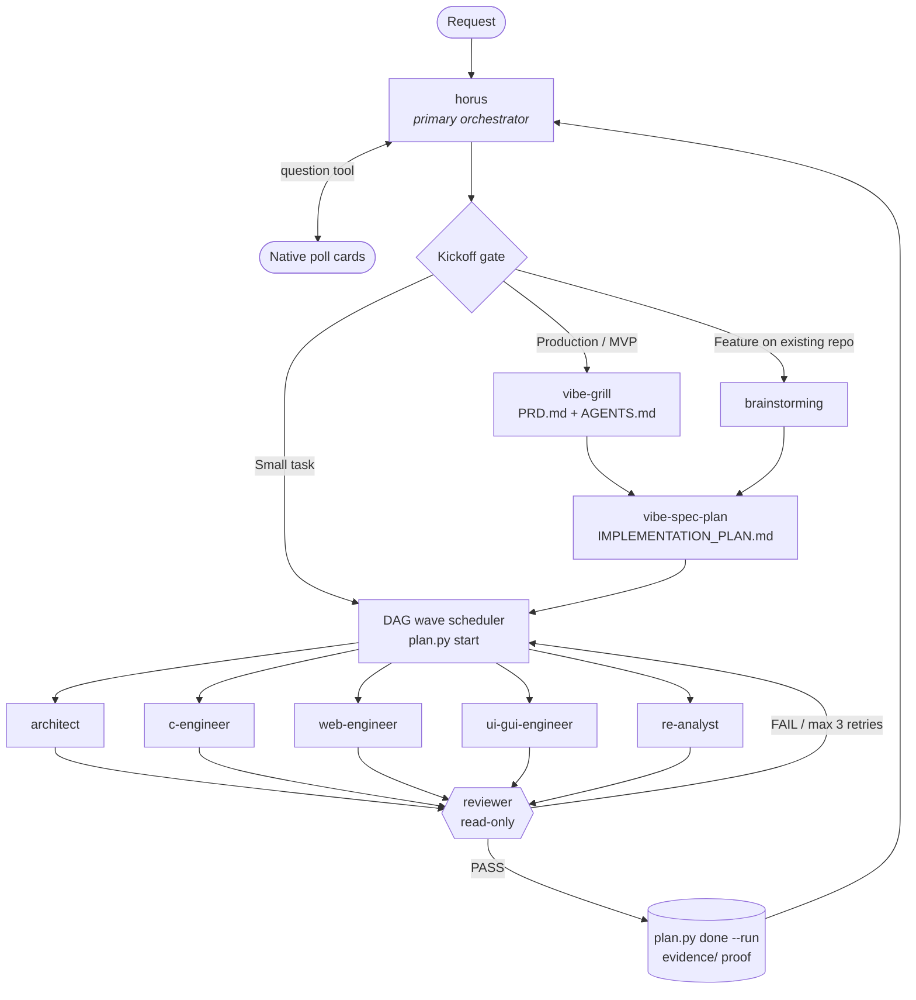

<div align="center">

# Horus Super Agent

**A DAG-wave orchestrator and 41-skill harness for [OpenCode](https://opencode.ai), Google Antigravity, and DeepSeek Harness Desktop App (`dsh`).**

Specs before code, file-locked parallel subagents, and proof-gated task closure —
with every decision surfaced as a native clickable poll instead of a wall of chat questions.

[](CHANGELOG.md)
[](#multi-harness-install-opencode--antigravity--deepseek-harness)
[](SKILLS.md)
[](#the-subagents)
[](#quick-start)
[](LICENSE)

</div>

---

## Why this exists

Most agent setups fail in three predictable ways: they start writing code before the
requirements exist, they claim work is done without proof, and they burn their context
window re-reading the same files.

Horus is a harness that makes those failures structurally hard:

| Failure mode | How Horus blocks it |
| :--- | :--- |
| **Code before specs** | Kickoff gate + `vibe-grill` interview produces `PRD.md` and a phased plan before any edit |
| **Hand-ticked "done"** | Tasks close only when `plan.py done --run "<cmd>"` exits 0 and writes a record to `evidence/` |
| **Context window drift** | `graphify-out/graph.json` AST graph + `HANDOFF.md` briefs instead of bulk file reads |
| **Parallel agents overwriting each other** | Every wave task declares `Owns Files`; only strictly disjoint sets run concurrently |
| **Silent disagreement** | Subagents can't prompt you — they return `DECISION_OPTIONS` and the orchestrator turns them into one poll |
| **Sycophantic review** | `reviewer` is read-only and returns `PASS`/`FAIL` with `file:line` findings and zero praise |

---

## How it works



### Adaptive pipeline routing

The orchestrator picks the smallest pipeline that can actually satisfy the request:

| Pipeline | Trigger | Sequence |
| :--- | :--- | :--- |
| `TRIVIAL` | ≤ 1 file touched | worker → verify |
| `STANDARD` | Multi-file feature | `architect` → worker wave → `reviewer` |
| `REVERSE-ENGINEERING` | Binary / legacy port | `re-analyst` (REA spec) → `c-engineer` → `reviewer` |
| `WEB` | Web product | `architect` → `web-engineer` wave → Playwright E2E → `reviewer` → `vibe-test-gate` |
| `CORE + UI` | Native app | `architect` freezes contract → parallel `c-engineer` + `ui-gui-engineer` → integration build → `reviewer` |

### Retry escalation

A failing task gets three escalating attempts, then a circuit breaker:

1. Re-dispatch with only `BLOCKERS`/`MAJORS` quoted at `file:line`.
2. Refresh the Graphify slice, attach the exact failing stderr, re-dispatch.
3. `plan.py block <id> "<reason>"` and a `Blocked` poll — *Expand Scope*, *Alternative Approach*, or *Keep Blocked & Handoff*.

---

## Quick start

**Requirements:** OpenCode (V1 or V2), Python 3.8+ for the plan/validation scripts,
Node.js 22.5+ (only if using `horus-context-mode` MCP), and PowerShell 5.1+ or bash.

### Install into a single repo (recommended)

```powershell
# Windows
.\install.ps1 -Mode project -TargetDir "C:\path\to\your\repo"
```

```bash
# Linux / macOS
bash install.sh project /path/to/your/repo
```

### Install globally for every OpenCode project

```powershell
.\install.ps1 -Mode global -ForceConfig
```

```bash
bash install.sh global --force-config
```

### Multi-Harness Install (OpenCode + Antigravity + DeepSeek Harness)

Horus keeps a single zero-duplication source of truth in `.opencode/` and adapts cleanly to **OpenCode (V1/V2)**, **Google Antigravity (IDE & `agy` CLI)**, and **DeepSeek Harness Desktop App / Web UI (`dsh`)** via `-Harness` / `--harness`:

```powershell
# Windows PowerShell — Google Antigravity (project or global)
.\install.ps1 -Mode project -TargetDir "C:\path\to\your\repo" -Harness antigravity
.\install.ps1 -Mode global -Harness antigravity

# Windows PowerShell — DeepSeek Harness Desktop App / Web UI (project or global)
.\install.ps1 -Mode project -TargetDir "C:\path\to\your\repo" -Harness dsh
.\install.ps1 -Mode global -Harness dsh

# Install for ALL three harnesses at once (OpenCode + Antigravity + DSH)
.\install.ps1 -Mode project -TargetDir "C:\path\to\your\repo" -Harness all
```

```bash
# Linux / macOS
bash install.sh project /path/to/your/repo --harness antigravity
bash install.sh global --harness antigravity
bash install.sh project /path/to/your/repo --harness dsh
bash install.sh global --harness dsh
bash install.sh project /path/to/your/repo --harness all
```

| Harness | Project Layout | Global Layout | MCP / Rules Integration |
| :--- | :--- | :--- | :--- |
| **OpenCode (V1/V2)** | `.opencode/{agents,skills,commands,context-mode}`, `AGENTS.md`, `opencode.jsonc` | `~/.config/opencode/` + strict `opencode.json` | Native `opencode.jsonc` / `opencode.json` |
| **Google Antigravity** | `.agents/{skills,workflows,rules,agents,context-mode}`, `GEMINI.md`, `.agents/mcp_config.json` | `~/.gemini/config/{skills,workflows,rules,agents,context-mode}` | Non-destructive merge into `~/.gemini/config/mcp_config.json` |
| **DeepSeek Harness (`dsh`)** | `skills/`, `AGENTS.md`, `.dsh/{agents,commands,context-mode,cordis.patch.yml}` | `$DSH_HOME/skills/` + `$DSH_HOME/horus/` | Ready-to-merge `@deepseek-ai/dsh-mcp-client` Cordis YAML patch (`cordis.patch.yml`) |

### Upgrade an existing install

`-ForceConfig` / `--force-config` overwrites `AGENTS.md` and `opencode.jsonc`,
saving a `.bak` of each first. Without the flag, existing config files are left untouched
and only agents, skills, and commands are refreshed.

```powershell
.\install.ps1 -Mode project -TargetDir "C:\path\to\your\repo" -ForceConfig
```

### Verify the install

```bash
python scripts/validate_horus.py
```

```
HORUS VALIDATION PASSED (project): 7 agents, 41 skills, 14 commands, 4 Vibe templates, 8 bilingual Vibe handbooks, 8 Graphify references.
```

The validator checks config parsing, `question` permissions on the primary agent,
`question`/`subagent` denial on every worker, absence of hardcoded `model:` fields,
skill frontmatter, strict 150-char description caps, zero sub-playbook collisions,
required commands, merged Vibe assets, and Python syntax.

### Optional companions

```bash
# Local AST knowledge graph + graphify-mcp server
uv tool install --upgrade "graphifyy[mcp]"

# Cross-session / cross-project Markdown wiki memory daemon (ai-memory)
# Linux / macOS:
curl -fsSL https://github.com/akitaonrails/ai-memory/releases/latest/download/install.sh | sh
# Windows (PowerShell):
# irm https://github.com/akitaonrails/ai-memory/releases/latest/download/install.ps1 | iex
ai-memory setup --yes --agent opencode2   # or --agent opencode for V1

# REA binary / PE analysis toolkit
npx -y rea-agents@latest setup

# Browser verification for webapp-testing
pip install playwright && python -m playwright install chromium
```

Graphify and REA MCP servers ship commented out in `opencode.jsonc` — uncomment once installed.
See [Memory, Context & Knowledge Graph Architecture](#memory-context--knowledge-graph-architecture)
before running `ai-memory setup` alongside Horus and Graphify.

---

## Memory, Context & Knowledge Graph Architecture

Horus separates context, code topology, execution proofs, and long-term memory into
**four non-overlapping layers**:

| Layer | Skill / Tool | Primary Job | Storage & Scope |
| :--- | :--- | :--- | :--- |
| **Codebase Topology** | `graphify` (`graphifyy[mcp]`) | Static AST knowledge graph: symbols, callers, god nodes, shortest paths, blast radius | `graphify-out/graph.json` (per-repo, derived from source) |
| **Long-Term Memory** | `horus-memory` (`ai-memory`) | Cross-session, cross-project & cross-agent durable Markdown wiki, decisions, gotchas, handoffs, inbox | `~/.local/share/ai-memory/` (git-backed user/team wiki) |
| **Session Output Sandbox** | `horus-context-mode` | SQLite FTS5 (BM25 + Trigram RRF) & sandboxed `ctx_execute` to keep huge logs/dumps out of context | `~/.horus-context-mode/context.db` (ephemeral/session FTS5 index) |
| **Execution State & Proof** | `planning-with-evidence` (`plan.py`) | Current repo DAG wave plan, file locks, proof logs, and local `HANDOFF.md` | `task_plan.md`, `evidence/`, `HANDOFF.md` (per-repo) |

### `horus-memory` (`ai-memory`) vs `graphify`

They solve **complementary problems** and work best together: `graphify` answers
*"How is this codebase wired right now?"* while `ai-memory` answers *"Why did we decide
this, what broke last time, and what happened in another session or repo?"*

| Dimension | `horus-memory` (`ai-memory`) | `graphify` (`graphifyy` v0.9.115) |
| :--- | :--- | :--- |
| **Core purpose** | Durable cross-session/cross-project/cross-agent memory, wiki pages, handoffs, repo-to-repo inbox | Structural codebase & document knowledge graph (AST calls, imports, communities, god nodes) |
| **Scope** | Global across all repos, sessions, machines & agents | Per-repository (or monorepo workspace) |
| **Storage** | `~/.local/share/ai-memory/` (standalone git-backed Markdown wiki) | `<repo>/graphify-out/` (`graph.json`, `GRAPH_REPORT.md`, optional `wiki/`) |
| **Runtime & Port** | Background Rust daemon + local HTTP hook server on `127.0.0.1:49374` | On-demand CLI (`graphify extract . --code-only`, `graphify update .`) + stdio MCP (`graphify-mcp graphify-out/graph.json`) |
| **OpenCode Integration** | OpenCode plugin (`~/.config/opencode/plugins/ai-memory.ts`), MCP server, and Horus's `horus-memory` skill (`/horus-memory`) | Optional MCP entry in `opencode.jsonc` and Horus's `graphify` skill (`/graphify`) |
| **MCP Tool Namespace** | `memory_*` (`memory_query`, `memory_write_page`, `memory_handoff_*`, `memory_message_*`, `memory_lint`, ...) | Graphify query/path/explain/report tools |
| **LLM Token Cost** | 0 LLM tokens for default capture, search, handoffs, and inbox | 0 LLM tokens for AST extraction (`--code-only`) and incremental updates |

### Future Conflict Check & Coexistence Rules

**Recommended Best-of-the-Best Setup (Source-Verified):** Keep **both** — they solve orthogonal problems and have **zero runtime, storage, port, or MCP namespace overlap**, and `ai-memory`'s OpenCode V2 plugin explicitly skips `parentID` child sessions so Horus's parallel subagents are never polluted:
- Run **`ai-memory`** as your **always-on OpenCode plugin + MCP** (`ai-memory setup --yes --agent opencode2`, then delete the 7 extra `ai-memory-*` skill folders).
- Run **`graphify`** in **CLI-first mode** by default (`graphify extract . --code-only`, `graphify query/path/explain`, `graphify update .`) — **zero** MCP tool-schema overhead, **100%** full AST power. Uncomment `graphify-mcp` in `opencode.jsonc` only in massive repos.
- **Never run `graphify opencode install`:** its `graphify.js` plugin mutates your first shell command with an `echo` reminder, which pollutes `ai-memory`'s `tool.execute.before/after` observation capture and duplicates Horus's `AGENTS.md` rule.

**Will `ai-memory` and `graphify` conflict now or in the future? No** (when following the setup above):
They have **zero runtime, storage, port, hook, or MCP namespace overlap**:
- **No file/git collision:** `ai-memory` lives in `~/.local/share/ai-memory/`; `graphify` writes strictly to `<repo>/graphify-out/`.
- **No port collision:** `ai-memory` binds `127.0.0.1:49374`; `graphify-mcp` communicates over stdio (no listening TCP port).
- **No MCP tool collision:** `ai-memory` exposes `memory_*` tools; `graphify-mcp` exposes graph-navigation tools under its own MCP server key.
- **No plugin/hook collision:** Only `ai-memory` registers an OpenCode plugin (`~/.config/opencode/plugins/ai-memory.ts`).

To keep the setup clean over future upgrades, follow **three operational rules**:

1. **Remove duplicate `ai-memory-*` skill folders after `ai-memory setup`:**
   Running `ai-memory setup --yes --agent opencode2` (or `--agent opencode` for V1) may
   write 7 standalone `ai-memory-*` skills into `~/.config/opencode/skills/`. Delete those
   7 folders — Horus already consolidates all 5 operational playbooks inside
   `.opencode/skills/horus-memory/` with zero catalog bloat and zero trigger overlap.
2. **Avoid `-ForceConfig` / `--force-config` on global upgrades after `ai-memory setup`:**
   `ai-memory setup` edits your global `opencode.json`. When upgrading Horus globally
   later, run `install.ps1 -Mode global` / `install.sh global` **without** `-ForceConfig`
   (or re-run `ai-memory setup --yes --agent opencode2` if you intentionally reset your
   global config).
3. **Keep codebase topology out of `ai-memory` durable pages:**
   Never copy raw `graphify-out/graph.json` or generated Graphify wiki dumps into
   `ai-memory`. Let `graphify` stay the live source of truth for code structure, and keep
   `ai-memory` focused on architectural decisions, debugging gotchas, user/team
   preferences, cross-session handoffs, and cross-repo messages.

---

## What's inside

```
horus-super-agent/
├─ AGENTS.md                  # harness rules: signal-only output, evidence gates, skill routing
├─ opencode.jsonc             # OpenCode V2 config (permissions array)
├─ opencode.v1.json           # OpenCode V1 config (permission map)
├─ install.ps1 / install.sh   # project-local and global installers
├─ .opencode/
│  ├─ agents/                 # horus + 6 subagents
│  ├─ commands/               # 14 slash commands
│  ├─ context-mode/           # Horus Context Mode MCP server + dashboard
│  └─ skills/                 # 41 skills
│     └─ vibe/                # 4 templates + 8 EN/AR handbooks
└─ scripts/
   ├─ validate_horus.py       # integrity validator
   ├─ sync_upstream.py        # replace offline editions with verbatim upstream
   ├─ migrate-opencode-db.py  # repair a V2→V1 opencode.db schema mismatch
   ├─ horus_foundry.py        # Linear-orchestrated parallel background OpenCode pods
   └─ horus_todo.py           # git-tracked .todo.md checklist, AI analysis & live sidebar
```

> **Troubleshooting OpenCode itself?** `scripts/migrate-opencode-db.py` (driven by
> `finish-db-migration.ps1`) moves a locked `opencode.db` aside, builds a fresh
> V1-schema database, and restores projects, sessions, messages, and parts from the
> old one. It always backs up first and supports `--dry-run`.

### The subagents

| Agent | Role | Writes? |
| :--- | :--- | :--- |
| `horus` | Primary orchestrator: polls, waves, gates, escalations | Coordinates |
| `architect` | Maps the codebase, freezes contracts, produces the DAG plan | Read-only |
| `c-engineer` | Modern C17/C23 and C++20/Win32 systems work | Yes |
| `ui-gui-engineer` | Win32/Direct2D, ImGui, GTK4, SDL3, Clay, and web UI craft | Yes |
| `web-engineer` | React/Next.js, Supabase/Postgres, performance, browser-verified delivery | Yes |
| `re-analyst` | REA/Ghidra/IDA binary analysis into evidence-backed specs | Read-only |
| `reviewer` | Spec, security, memory-safety, ABI, file-lock, and proof audit | Read-only |

Only `horus` may call the `question` tool. Workers that need a decision return
`STATUS: NEEDS_DECISION` with `DECISION_OPTIONS`, so you always get one clean poll.

### Slash commands

| Command | Purpose |
| :--- | :--- |
| `/horus-init` | Kickoff wizard: mode, lifecycle tier, subagent models, Graphify index, `plan.py init` |
| `/horus-status` | Progress, `plan.py verify` audit, active wave, git tree — zero fluff |
| `/horus-resume` | Cold-start or post-compaction recovery from `HANDOFF.md` and `task_plan.md` |
| `/horus-review` | Adversarial read-only review plus anti-test-theater audit on the current diff |
| `/vibe` | Enter the 7-stage Vibe Engineering workflow |
| `/graphify` | Official Graphify v0.9.115 knowledge graph build, query, path, explain, update, wiki & MCP |
| `/horus-context` | Horus Context Mode token-savings report (`ctx_stats`), `ctx_doctor`, JIT FTS5 search, or dashboard |
| `/horus-memory` | Cross-session/cross-project `ai-memory` wiki query, handoffs, inbox, lint & `ai-memory doctor` |
| `/horus-foundry` | Launch, dry-run, or check Linear-orchestrated parallel background OpenCode pods |
| `/horus-todo` | Git-tracked `.todo.md` checklist, 1-click AI Requirement Analysis, `plan.py` promote, or live sidebar |
| `/design` | Design Engineering 21-playbook suite (animations, gestures, `break-ui`, Stageshow faux-product-UI, prototyping, `DESIGN.md`, Apple/Swift) |
| `/craft` | Engineering Craft 18-playbook suite (deep modules, domain modeling, wayfinder, PR/triage/retro, bug diagnosis) |
| `/partner` | Senior Engineering Partner: `AUDIT:` report-first audit, Tier 0–2 rigor ladder, Cloud/K8s/Terraform/SRE/DR, compliance & toolchains |
| `/security` | Defensive AppSec, C/C++ memory/mitigations, CI/CD & supply-chain hardening audit |

### Evidence gates (`plan.py`)

```bash
python .opencode/skills/planning-with-evidence/scripts/plan.py init
python .opencode/skills/planning-with-evidence/scripts/plan.py status
python .opencode/skills/planning-with-evidence/scripts/plan.py next
python .opencode/skills/planning-with-evidence/scripts/plan.py start  T1.2
python .opencode/skills/planning-with-evidence/scripts/plan.py done   T1.2 --run "pytest -q"
python .opencode/skills/planning-with-evidence/scripts/plan.py block  T1.2 "missing API key"
python .opencode/skills/planning-with-evidence/scripts/plan.py verify --rerun
python .opencode/skills/planning-with-evidence/scripts/plan.py handoff --note "next: wire the parser"
```

Tasks are written as `- [ ] T1.1 Title | accept: <checkable command or file>`.
`verify` flags any `[x]` with no matching evidence record as `UNPROVEN`, which makes
editing a checkbox by hand useless.

---

## The skills

41 skills, grouped by purpose. Full provenance and upstream attribution in [SKILLS.md](SKILLS.md).

<details>
<summary><b>Orchestration, memory, security & systems (16 skills)</b></summary>

| Skill | Use it for |
| :--- | :--- |
| `subagent-driven-dev` | DAG waves, file locks, Dispatch/Result envelopes, smart retries |
| `planning-with-evidence` | `plan.py` progress, proof records, `HANDOFF.md` |
| `anti-hallucination-harness` | Evidence-backed claims, minimal output, honest blockers |
| `graphify` | Official Graphify v0.9.115 OpenCode skill + 8 references (AST graph, query/path/explain/section, wiki, MCP) |
| `horus-context-mode` | SQLite FTS5 (BM25 + Trigram RRF) & sandboxed `ctx_execute` MCP server to keep huge logs/outputs out of context |
| `horus-memory` | Cross-session, cross-project & cross-agent long-term Markdown wiki memory (`ai-memory` MCP/CLI) |
| `horus-next-steps` | State-aware 1-click `question` follow-up polls at the end of substantive tasks/waves (primary agent only) |
| `horus-foundry` | Linear-orchestrated parallel background OpenCode pods with isolated `git worktree` per ticket |
| `horus-todo` | Git-tracked `.todo.md` checklist with AI Requirement Analysis, `plan.py` promoter & live sidebar UI |
| `security-audit` | Defensive AppSec, OWASP/API/Auth, C/C++ mitigations & CI/CD hardening audit (CWE-grounded) |
| `agent-architecture-reference` | 17-chapter bilingual (EN/ZH) coding-agent harness architecture reference (queried via `ctx_search`) |
| `reverse-engineer-anything` | Binary, bundle, and archive inspection via REA |
| `cpp20-win32-re` | PE32/PE32+ analysis into clean C++20 `_WIN64` |
| `modern-c-mastery` | C11/17/23 UB elimination, arenas, sanitizers |
| `native-gui-architecture` | DPI, 120 fps rendering, threading, dark mode |
| `ui-ux-design-systems` | Spatial grids, OKLCH tokens, WCAG/APCA contrast + Audit, Document & Extend modes |

</details>

<details>
<summary><b>Vibe Engineering (6 skills + 4 templates + 8 handbooks)</b></summary>

| Skill | Stage |
| :--- | :--- |
| `vibe` | Master router across all 7 stages |
| `vibe-grill` | Socratic requirements interview → `PRD.md` |
| `vibe-spec-plan` | Edge-case matrix → phased `IMPLEMENTATION_PLAN.md` |
| `vibe-scoped-build` | Single-task diffs, root-cause fixes, clean checkpoints |
| `vibe-critique` | Anti-sycophancy review with confidence scores |
| `vibe-test-gate` | Anti-test-theater audit + 16-point launch gate |

Templates: `PRD`, `IMPLEMENTATION_PLAN`, `AGENTS` (EN and AR).
Handbooks: `workflow-7-stages`, `checklists`, `anti-patterns`, `prompt-blueprints` (EN and AR).

</details>

<details>
<summary><b>Web, data, MCP, design & documents (11 skills)</b></summary>

| Skill | Use it for |
| :--- | :--- |
| `speed-engineer` | Indexes, N+1, pagination, caching, skeleton states |
| `vercel-react-best-practices` | React/Next.js waterfalls and bundle size (70 rules) |
| `supabase-postgres-best-practices` | Schema, RLS, indexing, connection management (31 rules) |
| `frontend-design` | Distinctive web visual direction & typography |
| `design-engineering` | 21 full Design Engineering playbooks + 2 cheatsheets (motion, choreography, gestures, `break-ui`, Stageshow faux-product-UI kit, mobile/Swift) |
| `webapp-testing` | Playwright verification, screenshots, console logs |
| `mcp-builder` | Building high-quality TypeScript & Python MCP servers |
| `pdf` / `docx` / `xlsx` / `pptx` | Full document, spreadsheet, presentation & PDF engineering |

</details>

<details>
<summary><b>Engineering discipline (8 skills: 6 Superpowers v7.0.2 + `engineering-craft` + `senior-engineering-partner`)</b></summary>

`brainstorming`, `test-driven-development`, `systematic-debugging`,
`using-git-worktrees`, `finishing-a-development-branch`, `writing-skills`,
`engineering-craft` (18 playbooks), and `senior-engineering-partner` (Tier 0–2 rigor ladder, `AUDIT:` mode, 39 unique Cloud/SRE/DR/compliance/toolchain refs + 5 scripts).

</details>

---

## Configuration

`opencode.jsonc` sets `horus` as the default agent and allows the `question` tool
globally, while still prompting before `git push` and `rm -rf`:

```jsonc
{
  "default_agent": "horus",
  "instructions": ["AGENTS.md"],
  "permissions": [
    { "action": "question", "resource": "*", "effect": "allow" },
    { "action": "shell", "resource": "git push *", "effect": "ask" },
    { "action": "shell", "resource": "rm -rf *", "effect": "ask" }
  ]
}
```

No agent ships a hardcoded `model:`. Models are chosen per session — either inherited
or assigned per subagent through a kickoff poll — so the harness never fights your
provider setup.

### OpenCode V2 vs V1

- **V2** (default): `opencode.jsonc` and `.opencode/agents/*.md` use the `permissions` array.
- **V1**: copy `opencode.v1.json` over `opencode.json` (it already sets `"question": "allow"`).
  Skills and commands are identical in both.

---

## Contributing

- **Adding a skill:** follow `writing-skills`, keep frontmatter `name:` equal to the directory name, keep `description:` ≤ 150 chars, then run `python scripts/validate_horus.py`.
- **Replacing offline editions:** `python scripts/sync_upstream.py --dry-run` to preview, `--only <group>` to scope. Backups and commit pins land in `SOURCES.lock.json`.
- **Changing harness rules:** edit `AGENTS.md`, then `CHANGELOG.md`, then validate.

## Credits

Built on [OpenCode](https://opencode.ai) and shaped by
[`dsh-superagent-prototype`](https://github.com/deepseek-ai/dsh-superagent-prototype),
[vibe-engineering-playbook](https://github.com/abduallahJamal/vibe-engineering-playbook),
[superpowers](https://github.com/obra/superpowers),
[graphify](https://github.com/Graphify-Labs/graphify),
[ai-memory](https://github.com/akitaonrails/ai-memory),
[senior-engineering-partner](https://github.com/bjgreenberg/senior-engineering-partner),
[rea](https://github.com/morluto/rea),
[anthropics/skills](https://github.com/anthropics/skills),
[vercel-labs/agent-skills](https://github.com/vercel-labs/agent-skills), and
[supabase/agent-skills](https://github.com/supabase/agent-skills).

## License

[MIT](LICENSE)
